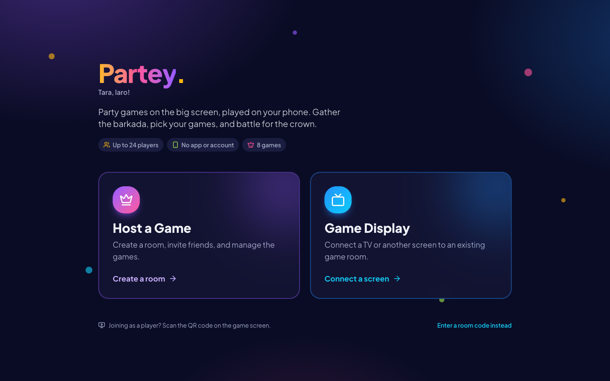
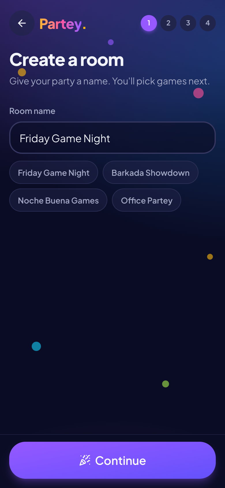
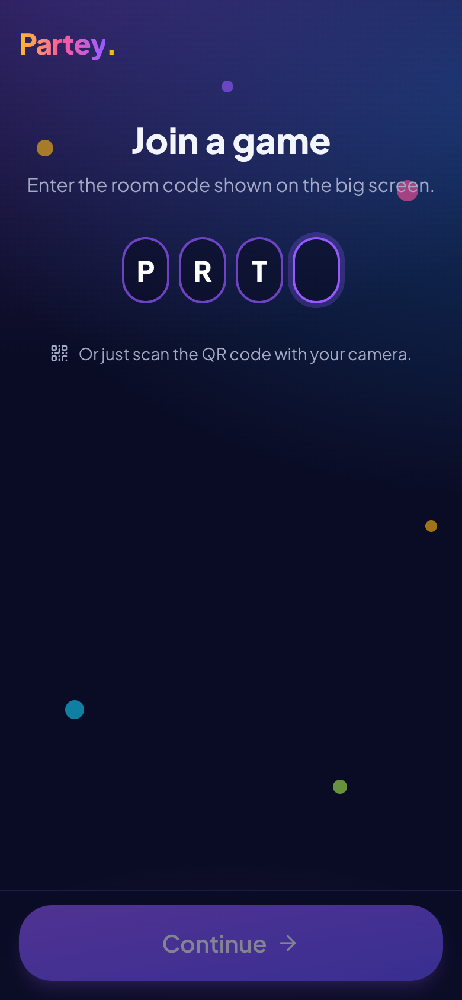

# Partey. — *Tara, laro!*

A real-time multiplayer party game platform. One device **hosts**, a TV or tablet is the **display**, and everyone **plays** on their phone. No app install, no accounts.

| Role | Route | Device | What it does |
|---|---|---|---|
| Landing | `/` | any | Choose *Host a Game* or *Game Display* |
| Host | `/host`, `/host/:roomId` (+ `/mode`, `/games`) | phone / tablet | Create room → pick mode → pick games → run the lobby and games |
| Display | `/display`, `/display/:roomId` | TV / monitor / tablet | Pair with a 6-digit code, then present the lobby, QR code, intros and leaderboards |
| Player | `/play`, `/play/:roomCode` | phone | Join via QR / room code, pick nickname + avatar, play |

**Stack:** React 19 · TypeScript · Vite · Tailwind CSS v4 · shadcn/ui (Radix) · Lucide · Zustand · Motion · Firebase (Auth, Firestore, Realtime Database, Cloud Functions v2, Hosting) using the modular SDK.

## Screenshots



<table>
  <tr>
    <td align="center" width="50%">
      <br>
      <sub><b>Host</b>: create a room from your phone</sub>
    </td>
    <td align="center" width="50%">
      <br>
      <sub><b>Player</b>: join with the room code (or scan the QR)</sub>
    </td>
  </tr>
</table>


<p align="center"><sub><b>Display</b>: pair a TV or monitor with a 6-digit code from the host</sub></p>

---

## Quick start (local, no Firebase account needed)

Everything runs against the **Firebase Emulator Suite** using a `demo-*` project, so no real credentials are required.

**Requirements:** Node 22+, Java 11+ (for the Firestore/RTDB emulators).

```bash
npm install
npm --prefix functions install
cp .env.example .env.local        # emulators are enabled by default
npm run build:functions
```

In one terminal:

```bash
npm run emulators                 # Auth, Firestore, RTDB, Functions (+ UI at http://127.0.0.1:4000)
```

In another:

```bash
npm run dev                       # http://localhost:5173
```

Open three browser windows (or devices on your LAN):

1. `/host`: create a room, choose a mode and games.
2. `/display`: in the host lobby, tap **Connect a display**, type the code on the display, then **Approve** on the host.
3. Scan the QR code on the display (or open `/play`) to join as a player.

> **Testing with real phones on your Wi-Fi:** run `npm run dev` (it already listens on all interfaces), open the app at your machine's LAN IP, and set `VITE_PUBLIC_APP_URL=http://<your-ip>:5173` in `.env.local` so QR codes point there. The app connects to the emulators on the same host automatically.
>
> **Behind a corporate/agent HTTPS proxy?** `npm run emulators` preloads `scripts/emulator-loopback-direct.cjs`, which keeps emulator-to-emulator traffic on localhost (firebase-tools otherwise ignores `NO_PROXY`). It has no effect when no proxy is set.

## Scripts

| Command | Description |
|---|---|
| `npm run dev` | Vite dev server |
| `npm run build` | Type-check + production build to `dist/` |
| `npm run typecheck` | Type-check the web app and Cloud Functions |
| `npm run lint` | oxlint |
| `npm run emulators` | Start Auth / Firestore / RTDB / Functions emulators |
| `npm run build:functions` | Compile Cloud Functions (`functions/lib`) |
| `npm run test:functions` | Unit tests (expiry policy, game scoring, payload safety) + emulator integration tests (expiry sweep) |
| `npm run test:rules` | Firestore security-rules tests (emulators must be running) |
| `npm run test:e2e` | Multi-device Playwright flows: room/pairing flow + full gameplay of all three games (emulators + dev server running) |

To run the function integration tests against running emulators:

```bash
FIRESTORE_EMULATOR_HOST=127.0.0.1:8080 FIREBASE_DATABASE_EMULATOR_HOST=127.0.0.1:9000 npm run test:functions
```

## Deploying to a real Firebase project

1. Create a Firebase project and enable **Anonymous** sign-in (Authentication → Sign-in method), **Cloud Firestore**, **Realtime Database**, and the **Blaze** plan (required for Cloud Functions and Cloud Scheduler).
2. Register a **Web app** and copy its config into `.env.local` (see `.env.example`), setting `VITE_USE_FIREBASE_EMULATORS=false`.
3. Point the CLI at your project: `npx firebase use --add` (replaces the `demo-partey` default in `.firebaserc`).
4. Optionally tune `functions/.env` (`PAIRING_CODE_TTL_SECONDS`, default 180).
5. Deploy:

   ```bash
   npm run build
   npx firebase deploy --only firestore,database,functions,hosting
   ```

6. **Enable Firestore TTL policies** so logically expired data is physically deleted (TTL is configured outside of `firebase.json`):

   ```bash
   gcloud firestore fields ttls update ttlAt     --collection-group=rooms           --enable-ttl
   gcloud firestore fields ttls update expiresAt --collection-group=displayPairings --enable-ttl
   gcloud firestore fields ttls update expiresAt --collection-group=pairingCodes    --enable-ttl
   gcloud firestore fields ttls update expireAt  --collection-group=rateLimits      --enable-ttl
   ```

7. Consider enabling **App Check** for the callable functions before a public launch.

## Project structure

```
shared/                 Types, constants, game catalog, expiry policy shared by web + functions
functions/src/          Cloud Functions (callables, RTDB presence trigger, scheduled expiry sweep)
firestore.rules         Firestore security rules (clients are read-only)
database.rules.json     Realtime Database rules (presence)
src/
  app/                  Router, providers, route guards
  components/ui/        shadcn/ui primitives (button, input, card, dialog, …)
  components/shared/    Logo, backdrop, avatars, room code, QR, code input, state screens
  features/
    landing/            Landing page
    host/               Create room, mode, game library, lobby/dashboard, controls
    player/             Join, waiting lobby, get-ready, results
    display/            Pairing, lobby, game intro, leaderboard, champion
    games/              One folder per game module + registry (independent of role UIs)
  hooks/                Auth, live Firestore subscriptions, presence, countdown
  services/firebase/    Firebase init, typed callables, Firestore refs, RTDB presence
  stores/               Zustand stores (auth, player profile, lineup draft, sound)
  utils/                cn, URLs, sound synth, device label
tests/
  e2e/flow.mjs          Multi-device end-to-end flow
  rules/                Firestore security-rules tests
```

See **[docs/ARCHITECTURE.md](docs/ARCHITECTURE.md)** for the data model, security model, pairing flow, presence and expiration design.

## Status

**Done and tested against the emulators**
- Landing, host room creation, game mode selection, game library, host lobby/dashboard, display pairing and lobby, player join and waiting lobby.
- Server-authoritative room lifecycle, display pairing (single-use, expiring, rate-limited, host-approved), presence/reconnection, room expiration with cleanup, and Firestore + RTDB security rules.
- **Game engine:** intro → question → reveal rounds with server-clock timers, live answer counts, early close when everyone has answered, pause/resume, skip round, reveal now, end game, automatic advance on timer expiry, idempotent submissions, per-player private results, and tournament placement points (100 / 60 / 30 / 10, ties shared) or freestyle per-game scoring.
- **Playable games:** Speed Quiz (8 questions, speed bonus), Guess the Majority (6 prompts, match the crowd) and Reflex Battle (5 rounds, false-start detection). The other five games show as *Coming soon*.

**Next:** The Impostor, Draw & Guess, Word Scramble, Picture Reveal and Survey Showdown (text, voting, drawing and private-clue interactions); host-editable scoring; PWA; App Check.
