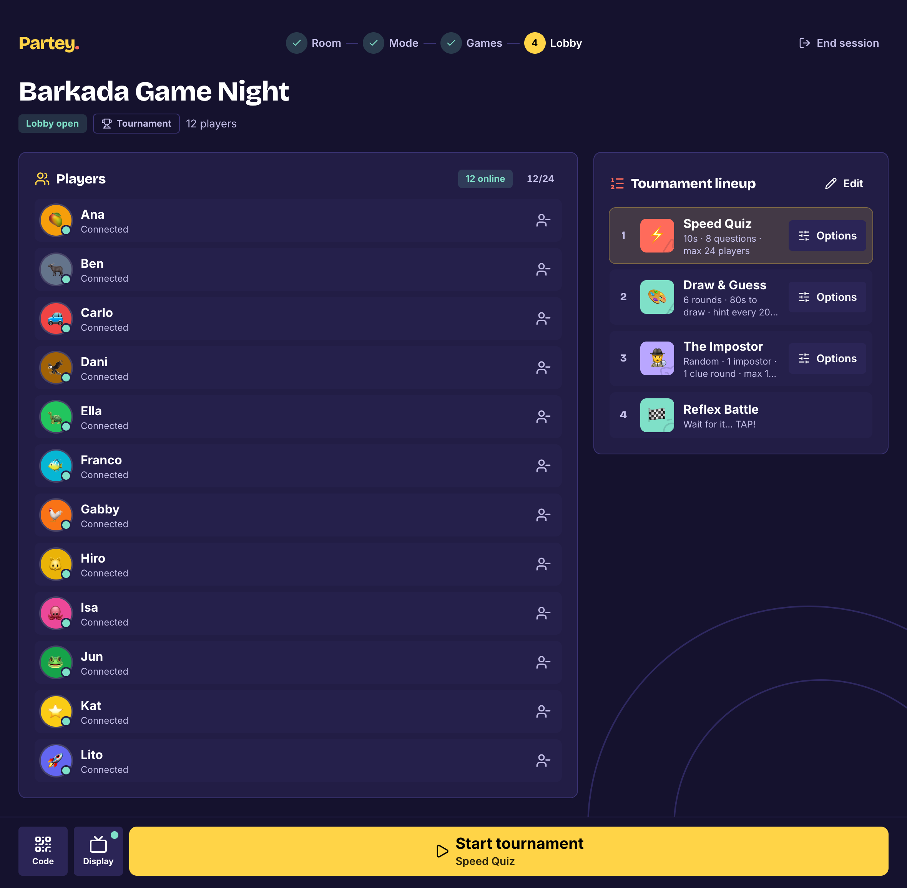
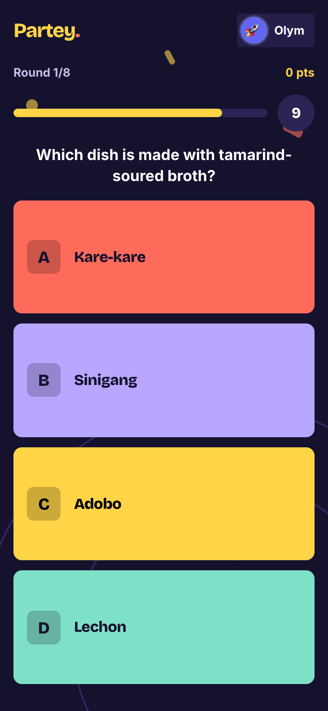
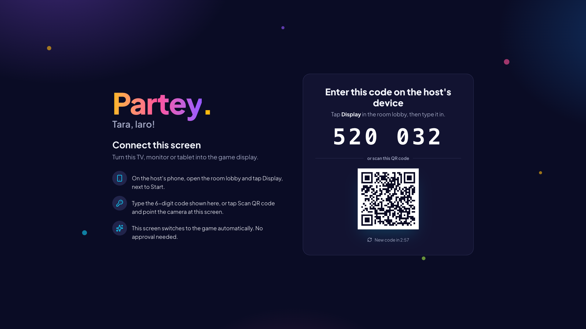

# Partey. — *Tara, laro!*

A real-time multiplayer party game platform. One device **hosts**, a TV or tablet is the **display**, and everyone **plays** on their phone. No app install, no accounts.

| Role | Route | Device | What it does |
|---|---|---|---|
| Landing | `/` | any | Choose *Host a Game* or *Game Display* |
| Host | `/host`, `/host/:roomId` (+ `/mode`, `/games`), `/host/pair/:code` | phone / tablet | Create room → pick mode → pick games → run the lobby and games |
| Display | `/display`, `/display/:roomId` | TV / monitor / tablet | Shows a 6-digit pairing code + QR for the host, then presents the lobby, join QR code, intros and leaderboards |
| Player | `/play`, `/play/:roomCode` | phone | Join via QR / room code, pick nickname + avatar, play |

**Stack:** React 19 · TypeScript · Vite · Tailwind CSS v4 · shadcn/ui (Radix) · Lucide · Zustand · Motion · Firebase (Auth, Firestore, Realtime Database, Cloud Functions v2, Hosting) using the modular SDK.

## Screenshots


<p align="center"><sub><b>Landing</b>: host a game or connect a screen</sub></p>


<p align="center"><sub><b>Host</b>: the lobby on a tablet, with 10 players in and a tournament lineup ready</sub></p>

<p align="center">
  <br>
  <sub><b>Player</b>: answering Speed Quiz on a phone</sub>
</p>


<p align="center"><sub><b>Display</b>: the TV shows a code; the host enters it or scans the QR</sub></p>

To regenerate these, run the emulators and dev server, then `node scripts/screenshots.mjs` (needs Playwright).

The favicon is `public/favicon.svg`. The social share image (`public/og-image.png`, 1200×630) and the PNG app icons are rendered from it and the brand fonts by `node scripts/brand-images.mjs` (needs Playwright); rerun it after changing either.

---

## Quick start (local, no Firebase account needed)

Everything runs against the **Firebase Emulator Suite** using a `demo-*` project, so no real credentials are required.

**Requirements:** Node 22+, Java 21+ (for the Firestore/RTDB emulators).

```bash
npm install
npm --prefix functions install
```

Local settings live in two gitignored files (only the emulators read them; `npm run build` and deploys keep using `.env`, i.e. production):

```bash
# .env.development.local  (read by `npm run dev` only)
VITE_USE_FIREBASE_EMULATORS=true
VITE_FIREBASE_PROJECT_ID=demo-partey
VITE_FIREBASE_DATABASE_URL=https://demo-partey-default-rtdb.firebaseio.com

# functions/.env.local  (read by the Functions emulator only; overrides functions/.env)
RTDB_URL=
```

In one terminal (builds the functions first):

```bash
npm run emulators                 # Auth, Firestore, RTDB, Functions (+ UI at http://127.0.0.1:4000)
```

Optionally, in another, rebuild functions on save so the emulator picks up changes:

```bash
npm run functions:watch
```

And the app:

```bash
npm run dev                       # http://localhost:5173
```

Open three browser windows (or devices on your LAN):

1. `/host`: create a room, choose a mode and games.
2. `/display`: the display shows a 6-digit code and a QR code. In the host lobby, tap the **Display** button beside *Start*, then type the code or tap **Scan QR code** to scan it with the host's camera. It connects automatically.
3. Once connected, the display shows the lobby with a join QR code. Scan it (or open `/play`) to join as a player.

> **Testing with real phones on your Wi-Fi:** run `npm run dev` (it already listens on all interfaces), open the app at your machine's LAN IP, and set `VITE_PUBLIC_APP_URL=http://<your-ip>:5173` in `.env.development.local` so QR codes point there. The app connects to the emulators on the same host automatically.
>
> **Behind a corporate/agent HTTPS proxy?** `npm run emulators` preloads `scripts/emulator-loopback-direct.cjs`, which keeps emulator-to-emulator traffic on localhost (firebase-tools otherwise ignores `NO_PROXY`). It has no effect when no proxy is set.

## Scripts

| Command | Description |
|---|---|
| `npm run dev` | Vite dev server (against the emulators) |
| `npm run build` | Type-check + production build to `dist/` |
| `npm run typecheck` | Type-check the web app and Cloud Functions |
| `npm run lint` | oxlint |
| `npm run emulators` | Build functions, then start the Auth / Firestore / RTDB / Functions emulators |
| `npm run functions:watch` | Rebuild Cloud Functions on save (for the Functions emulator) |
| `npm run deploy` | Build and deploy rules, functions and hosting to production |
| `npm run deploy:hosting` | Build and deploy only the web app to production |
| `npm run deploy:channel` | Build and deploy the web app to the `preview-partey` preview channel on production (own URL, 30 days; production backend) |
| `npm run deploy:preview` | Build (staging mode) and deploy rules, functions and hosting to the **staging** project (alias `preview`) |
| `npm run deploy:preview:hosting` | Build (staging mode) and deploy only the web app to staging |
| `npm run build:functions` | Compile Cloud Functions (`functions/lib`) |
| `npm run test:functions` | Unit tests (expiry policy, game scoring, payload safety) + emulator integration tests (expiry sweep) |
| `npm run test:rules` | Firestore security-rules tests (emulators must be running) |
| `npm run test:e2e` | Multi-device Playwright flows: room/pairing flow, full gameplay of Speed Quiz / Guess the Majority / Reflex Battle, a full game of The Impostor, a full game of Draw & Guess, a full game of Word Scramble, a full game of Perfectly Hold, and the free-tier host limits (emulators + dev server running) |

To run the function integration tests against running emulators:

```bash
FIRESTORE_EMULATOR_HOST=127.0.0.1:8080 FIREBASE_DATABASE_EMULATOR_HOST=127.0.0.1:9000 npm run test:functions
```

## Deploying to production

Production is the Firebase project **`partey-21c76`** (alias `prod` in `.firebaserc`). The `default` alias stays on `demo-partey` so a stray `firebase` command can never touch production; the deploy scripts pass `--project prod` explicitly.

**Config used by a deploy** (local dev overrides in `.env.development.local` / `functions/.env.local` are ignored):

| File | Used for |
|---|---|
| `.env` | Web app Firebase config, `VITE_MEDIA_BASE_URL` (R2 media) and optional `VITE_FIREBASE_MEASUREMENT_ID` (Google Analytics: page views plus `room_created`, `player_joined`, `game_started`; off in the emulators), baked into `dist/` by `npm run build` |
| `functions/.env` | `PAIRING_CODE_TTL_SECONDS` (default 180), `RTDB_URL` (the RTDB instance is in `asia-southeast1`), lobby expiry `ROOM_INACTIVITY_MINUTES` (60) and the free-tier host limits `MAX_ACTIVE_HOSTS` (30), `MAX_ROOMS_PER_HOST` (3), `HOST_INACTIVITY_MINUTES` (180) and `HOST_LIMIT_CONTACT_URL`. See `functions/.env.example`; paid hosts are tagged `tier: "paid"` in Firestore `hosts/{uid}` (docs/ARCHITECTURE.md → "Free-tier limits") |

Everything runs in **`asia-southeast1` (Singapore)**: Firestore, the Realtime Database and all Cloud Functions. The functions region is set in `functions/src/config.ts` and must match `VITE_FIREBASE_FUNCTIONS_REGION` in `.env`.

### Every release

```bash
npx firebase login                # once per machine
npm run typecheck && npm run lint
npm run deploy                    # build + rules + functions + hosting
```

Only the front end changed? `npm run deploy:hosting` is much faster. To ship a single piece:

```bash
npx firebase deploy --project prod --only firestore:rules,database   # security rules
npx firebase deploy --project prod --only functions                  # Cloud Functions
```

If a deploy reports functions that exist in the cloud but not in the code (e.g. after a rename), it asks before deleting them; add `--force` to accept non-interactively.

Live at **https://joinpartey.com/**.

### One-time setup (already done for `partey-21c76`)

1. Blaze plan (required for Cloud Functions and Cloud Scheduler); **Anonymous** sign-in enabled; Cloud Firestore and Realtime Database created in `asia-southeast1`.
2. A registered Web app whose config is in `.env` with `VITE_USE_FIREBASE_EMULATORS=false` (see `.env.example`).
3. Container image cleanup for Cloud Functions builds, so old images don't accrue storage costs:

   ```bash
   npx firebase functions:artifacts:setpolicy --project prod --location asia-southeast1 --days 1
   ```

4. Firestore TTL policies, so logically expired data is physically deleted (TTL is configured outside of `firebase.json`):

   ```bash
   gcloud config set project partey-21c76
   gcloud firestore fields ttls update ttlAt     --collection-group=rooms           --enable-ttl
   gcloud firestore fields ttls update expiresAt --collection-group=displayPairings --enable-ttl
   gcloud firestore fields ttls update expiresAt --collection-group=pairingCodes    --enable-ttl
   gcloud firestore fields ttls update expireAt  --collection-group=rateLimits      --enable-ttl
   ```

5. Before a public launch, consider enabling **App Check** for the callable functions.

## Staging

Two ways to try a release before production:

| | Preview channel | Staging project |
|---|---|---|
| Command | `npm run deploy:channel` | `npm run deploy:preview` (front end only: `npm run deploy:preview:hosting`) |
| What's separate | The web app only (its own URL on production) | Everything: web app, Cloud Functions, rules, Firestore, Realtime Database, data |
| Backend | **Production's** functions, data and rules | Its own |
| Good for | A quick look at UI changes, sharing a link | Testing server changes (functions, rules, limits) without touching production |

### Preview channel

`npm run deploy:channel` builds the production web app and deploys it to the Hosting channel **`preview-partey`** on `partey-21c76` (Firebase turns `_` into `-`, so `preview_partey` and `preview-partey` are the same channel). The CLI prints its URL (`https://partey-21c76--preview-partey-<hash>.web.app`); the channel expires after 30 days and is redeployed in place each time. Firebase authorises preview-channel domains for sign-in automatically.

Anything created on the preview (rooms, hosts) is **real production data**, and it runs against the **deployed** functions, so a server change can't be tried here until it's in production. For that, use the staging project.

### Staging project (alias `preview`)

A second Firebase project, fully separate from production. Config is kept apart so a staging deploy can never reach production:

| File | Used for |
|---|---|
| `.env.staging` (from `.env.staging.example`) | The staging web app config. `npm run build:staging` builds with `vite --mode staging`, which loads it on top of `.env`; **every** Firebase key must be set, or production's value would leak in |
| `functions/.env.preview` (from `functions/.env.preview.example`) | Staging function config, loaded on top of `functions/.env` when deploying with `--project preview`. Must set `RTDB_URL` (functions/.env has production's) |

`scripts/check-staging-env.mjs` runs before every staging build and refuses unless the `preview` alias is a real project other than production, `.env.staging` sets every key for that project with emulators off, and `functions/.env.preview` sets a non-production `RTDB_URL`. Staging builds are also kept out of search engines (`noindex` and a `robots.txt` that disallows everything).

**One-time setup:**

1. Create the project in the Firebase console (for example `partey-staging`; project IDs can't contain `_`) and repeat "One-time setup" above for it: Blaze plan, Anonymous sign-in, Firestore and Realtime Database in `asia-southeast1`, a Web app, artifact cleanup and the TTL policies (with that project's ID).
2. Put its ID in `.firebaserc` under `"preview"` (replacing `REPLACE-WITH-STAGING-PROJECT-ID`).
3. `cp .env.staging.example .env.staging` and fill in its Web app config; `cp functions/.env.preview.example functions/.env.preview` and set its `RTDB_URL`.
4. `npm run deploy:preview`.

## Media on Cloudflare R2

Large media (music for Speed Quiz, Guess the Majority, Reflex Battle, Impostor, Word Scramble, Draw & Guess and the display's waiting screens) is served from the Cloudflare R2 bucket **`partey-storage`**, not bundled with the app. The app reads the bucket's public URL from `VITE_MEDIA_BASE_URL` in `.env`. Leave it unset to run without music. Object keys live in `src/utils/media.ts`.

The bucket currently uses its public `r2.dev` URL, which Cloudflare rate-limits and intends for development. For production traffic, connect a custom domain (`npx wrangler r2 bucket domain add partey-storage --domain media.example.com --zone-id <zone>`) and update `VITE_MEDIA_BASE_URL`.

Upload or replace a track (requires `npx wrangler login`):

```bash
npx wrangler r2 object put partey-storage/music/speed-quiz/disco-funk-fever.mp3 \
  --file ./disco-funk-fever.mp3 --content-type audio/mpeg \
  --cache-control "public, max-age=31536000, immutable" --remote
```

Files are cached for a year, so upload a changed track under a new key rather than overwriting the old one.

## Project structure

```
shared/                 Types, constants, game catalog, expiry policy shared by web + functions
functions/src/          Cloud Functions (callables, RTDB presence trigger, Draw & Guess canvas trigger, scheduled expiry sweep)
firestore.rules         Firestore security rules (clients are read-only)
database.rules.json     Realtime Database rules (presence)
src/
  app/                  Router, providers, route guards
  components/ui/        shadcn/ui primitives (button, input, card, dialog, …)
  components/shared/    Logo, backdrop, avatars, room code, QR, code input, state screens
  features/
    landing/            Landing page
    host/               Create room, mode, game library, lobby/dashboard, controls
    player/             Join, waiting lobby, get-ready, results
    display/            Pairing, lobby, game intro, leaderboard, champion
    games/              One folder per game module + registry (independent of role UIs)
  hooks/                Auth, live Firestore subscriptions, presence, countdown
  services/firebase/    Firebase init, typed callables, Firestore refs, RTDB presence
  stores/               Zustand stores (auth, player profile, lineup draft, sound)
  utils/                cn, URLs, sound synth, device label
tests/
  e2e/flow.mjs          Multi-device end-to-end flow
  rules/                Firestore security-rules tests
```

See **[docs/ARCHITECTURE.md](docs/ARCHITECTURE.md)** for the data model, security model, pairing flow, presence and expiration design.

## Credits

Background music: Otomusu (https://otomusu.com/). Royalty-free under the [Otomusu terms](https://otomusu.com/5-2/); don't redistribute the audio files on their own.

- Speed Quiz: 「ディスコ・ファンク・フィーバー」 (Disco Funk Fever)
- Guess the Majority: 「丘の上の吹奏楽団」 (Brass Band on the Hill)
- Reflex Battle: 「宇宙ネコのスロットマシン」 (Space Cat's Slot Machine)
- Display while waiting for the host (pairing, lobby, between games): 「サンタの街はお祭り」 (Santa's Town Festival)

## Status

**Done and tested against the emulators**
- Landing, host room creation, game mode selection, game library, host lobby/dashboard, display pairing and lobby, player join and waiting lobby.
- Mobile-first layouts throughout, including the display (it works on a phone-sized screen up to 4K), with sticky bottom action bars.
- Host lobby keeps the room code and display pairing in pop-up sheets (the **Code** and **Display** buttons beside *Start*); the display can be connected by typing its code or scanning its QR with the in-app camera scanner.
- *Rejoin as host* is only offered for rooms that still exist and that you still own.
- Server-authoritative room lifecycle, display pairing (display shows the code, host enters it; single-use, expiring, rate-limited), presence/reconnection, room expiration with cleanup, and Firestore + RTDB security rules.
- **Game engine:** intro → question → reveal rounds with server-clock timers, live answer counts, early close when everyone has answered, pause/resume, skip round, reveal now, end game, automatic advance on timer expiry, idempotent submissions, per-player private results, and tournament placement points (100 / 60 / 30 / 10, ties shared) or freestyle per-game scoring.
- **Playable games:** Speed Quiz (speed bonus; the host sets 10s/15s/30s or no time limit, 8–20 questions and up to 100 players), Guess the Majority (6 prompts, match the crowd), Reflex Battle (5 rounds, false-start detection) The Impostor (secret roles, one-word clue turns, voting with revotes on a tie; the host picks the category or types their own single-use secret word, 1–3 impostors, clue rounds and max players), Word Scramble (tap the scrambled letters to spell the word; guess every 5 seconds, first answers score most; the host sets rounds, time, difficulty, category, hints and a speed bonus), Draw & Guess (one artist per round draws a secret prompt on their phone, live on the big screen; everyone else races to type the answer; letter hints appear every few seconds; the host sets rounds, drawing time, hint interval, prompt categories and max players) and Perfectly Hold (hold the button for the target time with no clock, timed on the phone; closest scores most; the host sets rounds and the target range). Picture Reveal, Survey Showdown, Number Rush, Cup Shuffle and Beer Pressure show as *Coming soon*.

**Next:** Picture Reveal, Survey Showdown, Number Rush, Cup Shuffle and Beer Pressure; host-editable scoring; PWA; App Check.
